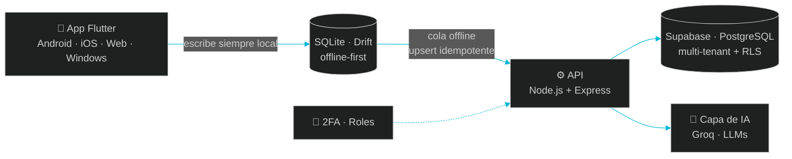

 

 

> *"Transformando la gestión empresarial a través de tecnología inteligente."*

Soy **CTO y AI Lead**: arquitecto y desarrollador FullStack. Diseño plataformas **SaaS multi-tenant**, sistemas de **facturación electrónica** y **asistentes de IA** que se integran a cada módulo del negocio, pensados para la realidad de Latinoamérica: conectividad inestable, normativa local y equipos pequeños que necesitan hacer mucho.

 

## ⚡ En qué me enfoco

<table>
  <tr>
    <td width="33%" valign="top">
      <h3>🤖 IA aplicada</h3>
      Asistentes con LLMs en cada módulo, vía <b>Groq API</b> y modelos locales para operar sin depender de la nube.
    </td>
    <td width="33%" valign="top">
      <h3>🏢 Multi-tenant</h3>
      Aislamiento de datos por empresa con <b>Row Level Security</b> sobre PostgreSQL.
    </td>
    <td width="33%" valign="top">
      <h3>📴 Offline-first</h3>
      Apps que siguen vendiendo sin internet: cola offline y <b>upsert idempotente</b> al reconectar.
    </td>
  </tr>
  <tr>
    <td valign="top">
      <h3>🧾 Facturación SAR</h3>
      Cumplimiento de la normativa fiscal de Honduras integrado al flujo de venta.
    </td>
    <td valign="top">
      <h3>🔐 Seguridad enterprise</h3>
      <b>2FA</b>, roles y permisos, y trazabilidad de cada operación.
    </td>
    <td valign="top">
      <h3>⚙️ Automatización RPA</h3>
      Procesos comerciales automatizados con evidencia verificable.
    </td>
  </tr>
</table>

 

## 🚀 Proyecto principal

### 🧠 Portal Pilot
**Plataforma SaaS con IA para la gestión de negocios** 
*"Del caos al control"*

ERP comercial integral para **pulperías, supermercados, distribuidoras y cadenas multi-sucursal**, con un asistente de IA en cada módulo.

| | Módulo | Qué resuelve |
|---|---|---|
| 🛒 | **POS** | Ventas con lector de códigos de barras |
| 📦 | **Inventario** | Multi-bodega y multi-sucursal |
| 🧾 | **Facturación** | Electrónica SAR (Honduras) |
| 👥 | **CRM** | Clientes y seguimiento comercial |
| 💰 | **Contabilidad** | Control financiero integrado |
| 👔 | **RRHH** | Gestión de personal |
| 🤖 | **Asistentes IA** | Ayuda contextual en cada módulo |

### 🏗️ Arquitectura

 

## 🧪 Otros proyectos

<table>
  <tr>
    <td width="50%" valign="top">
      <h3>📱 Portal Pilot App</h3>
      App <b>Flutter offline-first</b> para Android, iOS, Web y Windows. Base local con SQLite/Drift, cola offline y sincronización en la nube con IA integrada.  
      
      
      
    </td>
    <td width="50%" valign="top">
      <h3>🛰️ Alerta Sula</h3>
      Sistema de alertas en tiempo real para la red hidrometeorológica de Honduras, con simuladores interactivos (v1–v4) y API serverless.  
      
      
      
    </td>
  </tr>
  <tr>
    <td valign="top">
      <h3>🌐 InfiniHon Honduras</h3>
      Sitio web oficial de la marca: presencia digital corporativa con diseño cuidado.  
      
      
      
    </td>
    <td valign="top">
      <h3>📂 Todo el código</h3>
      12 repositorios públicos y creciendo.  
      
    </td>
  </tr>
</table>

 

## 🛠️ Stack

  

 

## 📊 Actividad

 

 

 

## 👥 Equipo

| 🧠 **Joseph Sánchez** | 🎯 **Amy Fajardo** | 🛡️ **Sofia Guzman** | ⚙️ **Jose Carcamo** |
|:---:|:---:|:---:|:---:|
| **CTO & AI Lead** | **CEO & Fundador** | **Head of Security** | **Desarrollo & RPA** |
| FullStack · IA Cloud · Groq API | Arquitectura · Cloud · Estrategia | Ciberseguridad · 2FA · Auth | Backend API · RPA · Trazabilidad |

 

## 📫 Hablemos

¿Quieres automatizar tu negocio, probar Portal Pilot o colaborar? Escríbeme o échale un vistazo a la demo.

 

Innovación · Calidad · Excelencia &nbsp;|&nbsp; Construido con pasión en Honduras 🇭🇳 para el mundo

